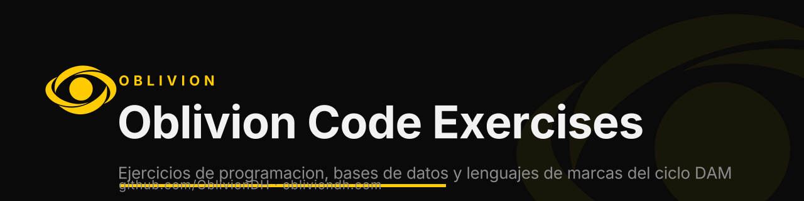

  

<h1 align="center">Oblivion Code Exercises</h1>

  
  
  
  

<b>Ejercicios de programacion, bases de datos y lenguajes de marcas del ciclo DAM. Material de estudio y practica. By Oblivion.</b>

`dam` · `programming` · `sql` · `databases` · `html` · `markup-languages`

---

## About Oblivion

Built by [**Oblivion**](https://obliviondh.com) — cybersecurity, cloud and AI. This tool is part of the Oblivion open-source toolkit.

- 🌐 Website: [obliviondh.com](https://obliviondh.com)
- 🎓 Learn: [Oblivion Academy](https://academy.obliviondh.com)
- 💬 Community: [Discord](https://discord.gg/f4mZBU9xS8)
- 🔗 All links: [linktr.ee/ivanbg2004](https://linktr.ee/ivanbg2004)
- 👤 Author: [Ivan Barnola Gasch](https://www.linkedin.com/in/ivanbg2004/)

Keywords: dam, programming, sql, databases, html, markup-languages, exercises, learning, study.

© 2026 Oblivion. If this project helped you, leave a ⭐ — it helps others find it.

